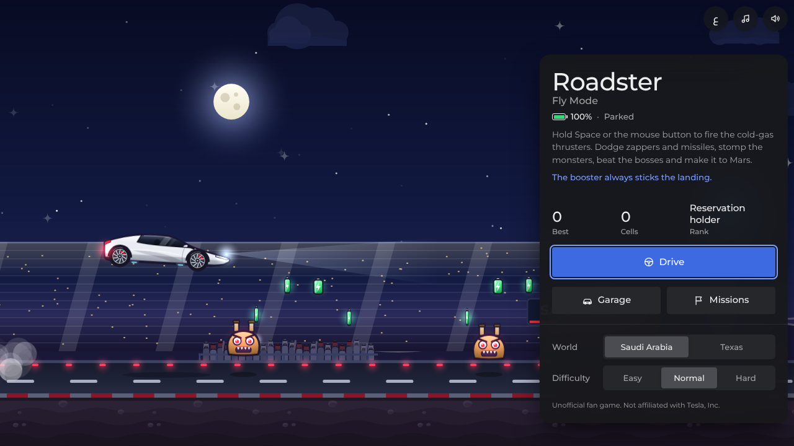
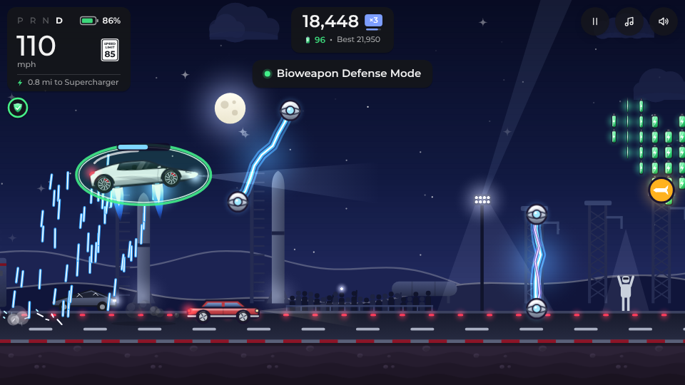
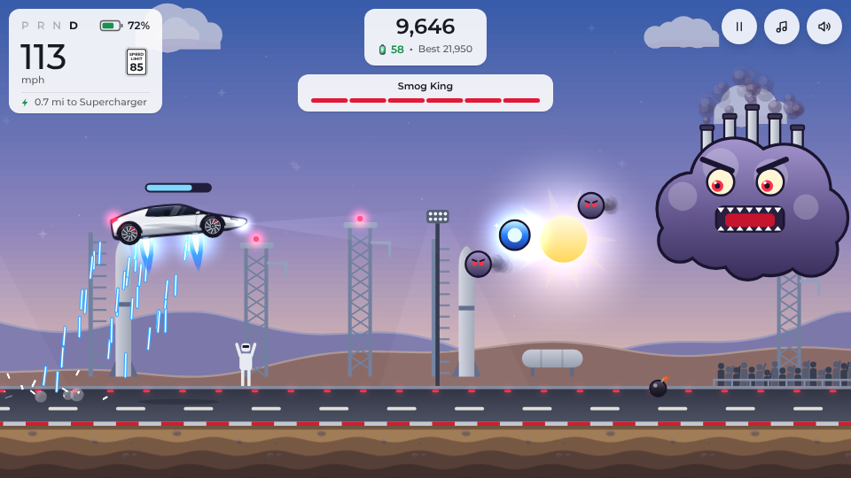
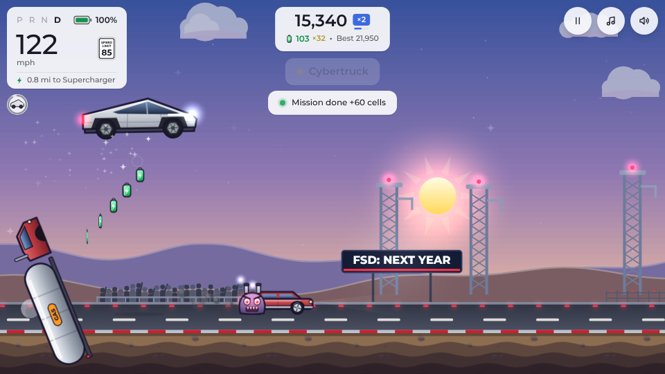
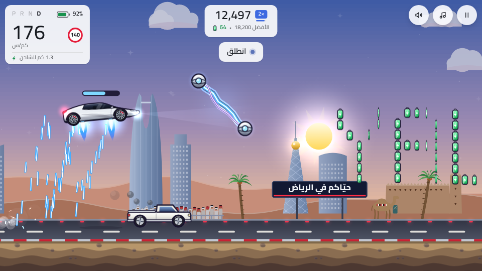

# Roadster: Fly Mode

A cartoon browser game inspired by the new Tesla Roadster's flying demo and by Jetpack Joyride. Fire the cold-gas thrusters, dodge zappers and missiles, hop gas cars, stomp monsters, beat two bosses and make it to Mars.

The game opens in Arabic, with an English switch on the title screen, and you can drive through Saudi Arabia or the original Texas launch site. The menus and dashboard are styled after Tesla's own screens, and you can install the game on your home screen and play it offline.

لعبة متصفح كرتونية: شغّل دافعات الغاز البارد، وتفادَ الصواعق والصواريخ، وادعس الوحوش، واهزم الزعماء، واوصل إلى المريخ. اللعبة بالعربية افتراضيًا مع زر للإنجليزية، ويمكنك اختيار عالم السعودية أو تكساس ومستوى الصعوبة، وتثبيتها على الشاشة الرئيسية واللعب بدون إنترنت.

> Unofficial fan game. Not affiliated with Tesla, Inc. or Halfbrick.

## Play

Open `index.html` in any modern browser on a phone or computer. There is no build step.

To play it online, turn on GitHub Pages (steps below).

## Install it and play offline

Once the game is online (GitHub Pages or any web server), it installs like an app and keeps working without a connection:

- **Android, or Chrome and Edge on a computer:** tap **Install app** at the bottom of the title panel, or choose **Install** from the browser menu.
- **iPhone and iPad:** tap the **Share** button, then **Add to Home Screen**. The **Install app** button on the title panel shows the same tip.

The game opens full screen from its icon. After the first visit everything it needs, including the fonts, is saved on the device, so it plays offline. When you're online it picks up new versions on its own. Opening `index.html` straight from your files plays fine but can't be installed, because browsers only allow that for web pages.

## Controls

| Action | Touch | Keyboard and mouse |
|---|---|---|
| Fire thrusters (hold), drop (let go) | Hold anywhere | Hold Space, ↑, W or the mouse button |
| Perfect launch | Tap the moment the light turns green | Press Space the moment it turns green |
| Pause | Pause button | P or Esc |
| Music on or off | Music button (in a run) or the music volume in Settings | N |
| Settings | Gear button on the title screen, or Settings on the pause screen | Same |
| Mute everything | Speaker button | M |
| Switch language | EN / ع button on the title screen | Same |
| Choose world and difficulty | Pickers on the title screen | Same |
| Install to the home screen | Install app button on the title screen | Same, or the browser menu |
| Cybertruck and Optimus: jump | Tap (hold for a higher jump; Optimus can jump again in the air) | Space, ↑, W or click |
| Starship: flip between road and sky | Tap | Space, ↑, W or click |
| Daily challenge | Daily tile on the title screen | Same |
| Share your run | Share button on the game-over screen | Same |

## What's in it

- A Tesla-style interface: a configurator-like title panel with Tesla blue buttons and segmented pickers, and an in-car dashboard with the gear (P R N D), speed, a speed limit sign, battery and the way to the next Supercharger, which goes light by day and dark by night like Tesla's Auto display
- Installs to the home screen and plays offline
- A Neon visual style in Settings: a synthwave sky with a striped sun, glowing mountain outlines, a neon road and a grid rushing underneath
- Night lighting: the scene darkens and the headlights cut a beam through it, with cells, zappers and Superchargers glowing in the dark
- Starman in the driver's seat: he waves on the title screen, ducks under zappers and missiles, and cheers on close calls, boss wins and vehicle pickups
- Barrel rolls: double-tap in the air to roll the car over for bonus points
- A crowd that jumps, waves and snaps phone photos as you fly past, and goes wild on big moments
- Animated menus: cards rise in, the score ticks up, and a new best pops with confetti
- Shiny paint, with a reflection sweeping across the car, and slow motion with a zoom on near misses
- Settings: music and sound effects volume, speed units (auto, km/h or mph), graphics quality, reduced motion and vibration
- Saudi holidays: fireworks and a free Saudi green paint on National Day and Founding Day, lanterns and a crescent moon through Ramadan, and double cells at Eid (dates follow the Umm al-Qura calendar; add `?event=national`, `founding`, `ramadan` or `eid` to the address to preview one)
- Wheel styles (Aero, Turbine, Arachnid, Gold) and thruster colours to buy in the Garage
- Race your best run: a see-through ghost of your best (and of today's best daily) flies alongside, with a marker when it's off screen; switch it off in Settings
- Phone vibration on crashes, stomps, smashes, boss hits, wrecked vehicles and finished missions (Android; iPhone browsers don't support it)
- Vehicle pickups, like Jetpack Joyride's: a Cybertruck that smashes through cars, drones and monsters, Optimus with a double jump and a landing shockwave, and a Starship that flips between the road and the sky. Each lasts 16 seconds or until it takes a hit, which throws the Roadster clear instead of ending the run
- A daily challenge: the same course for everyone each day (the world alternates between Saudi Arabia and Texas), today's best, and a streak that pays 100 cells a day, up to 700
- A share card: one tap makes a picture of your run (the road just before you crashed, your score, distance, cells and top speed) to post on WhatsApp, Snapchat or X
- Two worlds for Earth: Saudi Arabia (Riyadh's Kingdom Centre and Al Faisaliah, Najdi mud-brick from Diriyah, palms, dunes, camels, Bedouin tents, AlUla's Elephant Rock and NEOM's The Line, with a Dust King boss) and the Texas launch site
- Arabic (right to left, km/h and km) and English, switchable on the title screen
- Easy, Normal and Hard difficulty: speed, obstacle spacing, battery drain, missiles, zappers and boss toughness all change, and harder levels score more
- Cold-gas thrusters that spool up, ease off under the top of the sky and light the road beneath you, with a spring in the car's tilt and wheels that blur at speed
- Cold-gas thrusters that spray the road, a loop-the-loop and Superchargers to keep the battery alive
- Tesla-coil zappers (standing, hanging, diagonal and spinning) and missiles that track your height before they fire
- Battery cells laid out in hearts, stars, arrows and words
- Monsters you stomp by landing on them or blast with the thrusters
- Two boss fights, the Smog King and the Mothership, won by grabbing blue coil orbs
- A Mars zone with its own monsters, scenery and music
- Power-ups: Plaid mode, Tesla coil, Bioweapon defense, Fly mode and Not a Flamethrower
- Missions, ranks, upgrades, eight paint colors (including Saudi green) and an Emissions Testing Mode easter egg
- An original chiptune soundtrack and sound effects, all synthesized in the browser
- Progress saved in the browser with localStorage

## Put it online with GitHub Pages

1. Open the repository on GitHub and go to **Settings → Pages**.
2. Under **Build and deployment**, set **Source** to **Deploy from a branch**.
3. Choose the `main` branch and the `/ (root)` folder, then select **Save**.
4. After a minute or two the game is live at `https://<your-username>.github.io/<repository-name>/`.

## How it's built

The game lives in one self-contained `index.html`: cartoon art drawn with canvas paths at full screen resolution, a Web Audio synthesizer with a small step sequencer for the music, and no external assets apart from optional Google Fonts (Montserrat for English, Cairo for Arabic). If a device can't keep up, the game lowers its canvas resolution automatically. Physics runs at a fixed 120 steps a second, and each frame is drawn part of the way between the last two steps, so motion stays smooth on 60, 90, 120 and 144 Hz screens.

Three small extras make it an installable app: `manifest.webmanifest` (name, icons, full-screen display), `sw.js` (a service worker that saves the game and its fonts for offline play) and the icons in `icons/`, drawn from the game's own Roadster.
